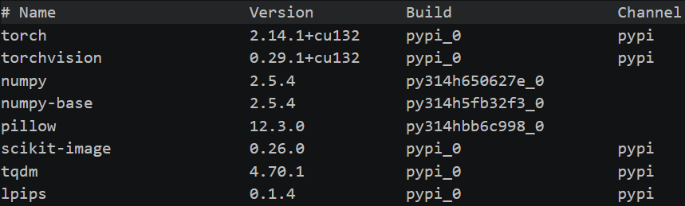

# Part1 基础
## 任务一：无雨 = 有雨 - 雨层？
### 基础问题
残差学习
模型学习从有雨图提取特征图，从特征图学习雨层，从雨层特征图重建雨层，再用**无雨 = 有雨 - 雨层**，然后修复图与真实无雨图比较，得到损失，反向传播，更新模型学习雨层的参数
理由：
1. 雨丝相对背景是稀疏、局部、加性的干扰，学习“雨层”比直接生成整张图更容易。
2. 残差分支只需学习差异部分，背景不会受影响，减少背景被破坏。
### 附加问题
#### 模型如何分辨谁是雨丝？
首先图片要经过多层卷积得到多张特征图，下面都是基于对特征图的学习
1. 利用方向性（雨丝线条通常为朝着一个方向的平行直线）
2. 多尺度（同时关注多种分辨率的图片，多种感受野，不同层级特征的融合，区分雨丝与纹理）
3. 颜色亮度先验（雨滴可能会使局部对比度下降，饱和度降低，颜色偏灰白，亮度偏移）
4. 频域特征（任何一张图像，都可以分解成许多不同频率、不同方向的正弦波的叠加。雨丝是细线结构，在垂直于雨丝的方向上，像素值快速变化，所以包含方向性高频成分，经过*傅里叶变换*得到的频谱图中与雨丝方向垂直的某个方向上，表现为亮带；*小波变换*后在特定方向的高频子带上产生较强响应，同时保留一定空间位置信息）
5. 注意力机制（给雨丝区域和可能表示雨丝的通道更高的权重）
#### 大模型还有可能复原出原来的物体吗？
不能恢复真实细节，可能接近，具体要看雨层对背景的影响
1. 模型本质是根据上下文，依据一定方法数学预测合理内容，当背景被雨丝覆盖时，模型不知道被挡住的到底是什么，只能根据数学预测并生成
2. 生成图可能峰值信噪比（PSNR）与结构相似性（SSIM）低，但感知指标高，也就是说图像自然合理但与真实图不同

## 任务二：怎么优化你的模型？
### 目标函数
#### L1、L2 范数的定义是什么？在几何意义上表示什么意思？请你用简单的例子进行解释
1. L1：$||X||_1=\sum_{i}|x_i|$,在几何上表示曼哈顿距离
2. L2：$||X||_2=\sqrt{\sum_{i}(x_i)^2}$，在几何上表示欧氏距离
对于二维向量(x,y)，其L1范数为$|3|+|4|=7$,表示当只能沿坐标轴方向移动时，移动向量(x,y)所要移动的距离；其L2范数为$\sqrt{3^2+4^2}=5$,表示直接移动向量(x,y)所要移动的距离
#### 在使用 L1、L2 损失函数时，计算过程是怎样的？它是如何从两张图片（模型输出和真实无雨图）得到一个最终的损失值的？
1. L1损失函数（MAE/绝对值误差）：$$L_1=\frac{1}{n}\sum_{i}|y'_i-y_i|$$
2. L2损失函数（MSE/均方误差）：$$L_2=\frac{1}{n}\sum_{i}(y'_i-y_i)^2$$
其中$y'_i$表示模型输出的预测出无雨图的像素，$y_i$表示真实无雨图的像素
### 评估指标
$$SSIM=\frac{(2\mu_{hat}\mu_{true}+C_1)(2\sigma_{hat,true}+C_2)}{(\mu_{hat}^2+\mu_{true}^2+C_1)(\sigma_{hat}^2+\sigma_{true}^2+C_2)}$$
$\mu_{hat},\mu_{true}$表示预测图与真实图的局部平均值，反应图片的亮度
$\sigma_{hat,true}$表示两张图片的协方差，反应结构相关度
$\sigma_{hat},\sigma_{true}$表示两张图片的标准差，反映图片对比度
1. SSIM 的数值范围是多少？
[-1,1]，但在自然图像比较中一般取[0,1]
2. SSIM 对图片的考虑主要从哪几个角度？
如公式上所写，考虑的是亮度，对比度与结构相关性
3. 不同于 PSNR，SSIM 每一次的评估对象是什么？
SSIM每次评估的是局部图像，而不是像PSNR一样对整张图每一个像素做计算
## 任务三：我有说明书，太好啦
### 环境搭建：小菜一碟

### 实现一个简单的模型
1. 基本模型
```
0 I_rainy
1 Conv2d 3x3, 3→64
2 Residual Block x 8(
    input 
    Conv2d 3x3
    BatchNorm2d
    ReLU
    Conv2d 3x3
    BatchNorm2d
    ReLU  latest_result+ input
    output
)
3 Conv2d 3x3, 64→3
4 I_clean = I_rainy - R_hat
```
2. 完整代码
```
import torch.nn as nn

class ResidualBlock(nn.Module):
    def __init__(self,channels = 64):
        super().__init__()
        self.body = nn.Sequential(
            nn.Conv2d(channels,channels,kernel_size=3,
                stride=1, padding=1,bias=False),
            nn.BatchNorm2d(channels),
            nn.ReLU(inplace=True),
            nn.Conv2d(channels,channels,kernel_size=3,
                stride=1, padding=1,bias=False),
            nn.BatchNorm2d(channels),
        )
        self.ReLU = nn.ReLU(inplace=True)
    
    def forward(self, x):
        return self.ReLU(self.body(x) + x)

class BaselineNet(nn.Module):
    def __init__(self, in_out_channel = 3, channels = 64, num_blocks = 8):
        super().__init__()
        self.head = nn.Conv2d(in_out_channel,channels,
            kernel_size=3,stride=1, padding=1,bias=False)
        self.block = nn.Sequential(
            *[ResidualBlock(channels) for _ in range(num_blocks)]   # *解包列表
        )
        self.tail = nn.Conv2d(channels,in_out_channel,
            kernel_size=3,stride=1, padding=1,bias=False)
    
    def forward(self, x):
        feat = self.head(x)
        feat = self.block(feat)
        rain = self.tail(feat)
        clean = x - rain
        return clean
```
#### 针对此问题，请你思考并寻找可能的解决方案
根据 CNN 的卷积计算原理，一个 3x3 的卷积核在当前层只能感受到附近 3x3 区域的信息，无法捕捉长距离依赖（例如贯穿图片的雨线）。在分类任务中，模型通过池化层不断减小特征图尺寸来扩大感受野，但在去雨任务中，我们通常希望保持原始分辨率。这意味着需要堆叠非常深的网络才能让像素间进行远距离信息交流，而深层网络会带来梯度消失、训练困难等问题。
ps:我自己想怎么可能想的来，最多就想到多尺度分支，注意力这些我在做前面问题时学到的一些方法
1. 多尺度分支：把同一张特征图送入不同分辨率（不下采样加上不同下采样）的分支并行处理，再融合
2. 空洞卷积：
将3*3卷积由
■ ■ ■ 
■ ■ ■ 
■ ■ ■ 
变成
■ □ □ ■ □ □ ■ 
□ □ □ □ □ □ □ 
□ □ □ □ □ □ □ 
■ □ □ ■ □ □ ■ 
□ □ □ □ □ □ □ 
□ □ □ □ □ □ □ 
■ □ □ ■ □ □ ■ 
在不改变参数量的情况下让卷积核覆盖更大的区域
但容易有一些地方覆盖不到
3. U-Net 编解码
    1. 编码器多次卷积+下采样
    2. 每次下采样产生的特征图直接与解码时的反卷积产生的特征图拼接
    3. 通道数翻倍
    4. 卷积变回原通道数
也就是与多尺度分支结合+跳跃连接
4. 注意力
    1. 通道注意力
    对特征图每个通道乘上一个权重s
    $$s=sigmoid(W_2ReLU(W_1z))，z=\sum_{i,j}p_{ij}$$
    p是特征图每个通道全局平均池化值，$W_1,W_2$是全连接层，s正向传播时会计算，反向传播时会更新参数
    2. 空间注意力
    生成一张与原图一样大小的权重图，告诉模型那些地方应该注意
5. 非局部模块
$$y_i=\frac{1}{C(x)}\sum_{j}f(x_i,x_j)g(x_j)$$
$C(x)$为归一化因子，$f(x_i,x_j)$为位置$x_j$对$x_i$的关系，$g(x_j)$为对$x_j$的变换
意义为根据$x_j$以及位置$x_j$对$x_i$的关系得到新特征$y_i$，再经过经过变换和残差连接加回原特征$x_i$
6. Transformer
ps:看不懂定义，尽量自己解释一下
一个窗口在特征图上滑动，对窗口内的进行注意力加权
7. 递归/渐进式网络
就和前面写的代码一样，重复执行一个模块ResidualBlock，进行多次学习雨层并反复优化
### 这个代码是什么意思？
1. 以下是运行结果
    
2. 之前再C语言里就学过可以通过命令行往main里面传参数，这下在python里也会了
    如何实现：
    1. 首先导入argparse库
    2. 然后最好是写一个用来获取命令行参数的函数
    3. 在函数中定义一个自己的`self_parser=argparse.ArgumentParser(description="程序说明")`
    4. 之后在函数中写`parser.add_argument(--name,type="")`下面是可填的参数

    |参数|	作用|
    |---|---|
    |--name|	参数名|	
    |type|	类型转换|
    |default|	默认值|
    |required|	是否必填|
    |choices|	限定可选值|
    |help|	帮助说明|
    |action|	特殊行为|
    |nargs|接受值数量|

    布尔值不能直接写，要使用`parser.add_argument("--name",action="store_true")`
    6. 调用该函数
3. 最初没写考虑mse为0的情况

# Part2 提高
## 第一部分 首先成为搭积木高手
### 任务二：试试看前人的杰作
1. **为什么 DerainNet 要先下采样后上采样？**下采样、上采样是什么？什么是 Concat？
去雨需要判断贯穿整图的雨线，3×3卷积在原分辨率下感受野太小，下采样让低分辨率感受野增大，上采样则恢复到原尺寸，让输出与输入同尺寸。三个分支分别处理原图、1/2、1/4 分辨率，可以兼顾细节和全局，最后上采样回原尺寸才能Concat
下采样：通过池化或步长卷积降低特征图空间分辨率，把特征图的空间尺寸变小，使同样大小的卷积核覆盖更大的原图区域，从而扩大感受野
上采样：通过插值或转置卷积恢复空间分辨率，把特征图的空间尺寸变大
concat:把多个tensor沿某个维度首尾相接，不改变其他维度，要求除拼接的维度以外，其他维度大小必须一致，所以之前才需要上采样

DerainNet运行结果


2. 将你的疑惑和学到的新知识写在 markdown 中
    1. 疑惑：
    在ResBlock中不是已经有过一次加残差的过程了吗，为什么还要与处理前的图片相加，这不就变成了*2x+残差*了吗
    2. 新知识：
    concat和cat是同一个函数的不同名字
    上采样函数interpolate(, size=(), mode=" ", align_corners=)

    |mode|	适用维度|	说明|
    |---|---|---|
    |"nearest"|	任意|	最近邻，最快，有块状感|
    |"bilinear"|	4D (N,C,H,W)|	双线性，平滑，最常用|
    |"bicubic"|	4D|	双三次，更平滑，稍慢|
    |"area"|	4D|	区域插值，适合下采样|
    |"trilinear"|	5D|	三线性，用于 3D 数据|

    双线性插值是在插值时取周围4个整数像素按距离加权平均
    align_corners双线性插值时角像素如何对齐(看不懂解释,求求不要考我)

### 附加1：还得自己找更好的方法
#### 请你将调研的每一篇文章体现在 markdown 文件中，需要看到对文章方法的理解和对你的启发
##### SPANet
###### 对文章方法的理解
1. 要解决的问题
    1. 真实雨数据难获取
    利用时间先验和人工监督
        - 对每个像素，在时间序列上观察其强度变化
        - 雨丝覆盖时强度会偏离背景，未覆盖时接近背景
        - 利用这种统计特性估计背景值
        - 对估计不可靠的区域，引入人工标注/筛选
    2. 现有方法缺乏空间注意力，难以处理方向多样的真实雨丝

2. 模型SPANet
```
输入
特征提取（轻量RB）
多个SPA
    1. 方向注意力：四方向循环累积1*1卷积，提取局部方向信息
    2. 全局通道注意力，提取非局部上下文
    3. 融合生成空间注意力图
    4. 特征加权
    5. 残差连接
重建头
输出
注意力显式监督
ps:为了实现注意力显式监督，所以修改了一点main函数
     对每个SPA的注意力图A(B, C, H/4, W/4):
        1. 上采样: A_up = interpolate(A, size=(H, W))
        2. 通道平均: A_1ch = A_up.mean(dim=1, keepdim=True)   # (B, 1, H, W)
        3. 生成软标签: M = clamp(|rainy - clean|, 0, 1)        # (B, 3, H, W)
        4. 标签通道平均: M_1ch = M.mean(dim=1, keepdim=True)  # (B, 1, H, W)
        5. 数值稳定: A_1ch = clamp(A_1ch, 1e-6, 1 - 1e-6)
        6. BCE: loss += BCE(A_1ch, M_1ch)
    最终loss = 各SPA损失的平均
```
###### 对你的启发
显式监督可以为模型提供一个额外的loss项，让模型会参考其进行更新
注意力图可以靠人工生成再让ai学
之前学到的动量法中的积累在提取特征时也可以使用
消融实验，可用于验证某些模块是否有用,运行结果图中可以显著看出有所提升
###### 运行结果
1. 有注意力显式监督
    
2. 无注意力显式监督
    
#### 调研单图像去雨的文章？那么应该怎么找到需要的文章呢？请总结你寻找文章的方法
额，我只关注了SPANet这一篇文章，不过如果让我去找的话，可能会用以下方法：
1. 搜索引擎
2. 论文网站
3. 计算机视觉相关期刊的综合网站
4. 问AI，提示词：单图像去雨，论文/研究成果；或者直接让ai去论文网站/计算机视觉相关期刊的综合网站上找符合要求的论文
#### 调研文章时，想必会遇到英文看不懂、文章看不进去、理解不了作者的方法等问题。在面对这些问题时，你会怎么解决呢？请总结你处理一篇文章的方法
1. 先尝试自己看，不懂得查单词（太折磨了，引言就看不懂）
2. 翻译软件翻译＋ai翻译
3. 看不懂的地方自己查搜索引擎或者问ai
4. 按照自己的理解写整个方法路径
5. 方法路径写好后让ai帮忙对照论文指出错误

#### 现有的文章中训练的设置，好像有个什么叫 ”渐进式训练“ 的东西。这是个啥？为什么现在这些工作都用这个作为训练的范式？这和出题人给出的训练方法之间有什么区别？它的优劣在哪？如果未来，你也开始投入科研，你是否应该如这些文章一样遵循已有的训练范式呢？
1. 渐进式训练：设计一套由易到难的训练套路，让模型逐步掌握最终目标一般来说分为
    1. 基于模型架构的渐进
    用多个模型逐步去雨，每个模型的处理结果传给下个模型继续精修
    2. 基于训练数据的渐进
    按照图片的大小以及难度逐步提供给模型学习，先学简单，再学困难
2. 为什么用
渐进式学习的核心思想：分治，引导
可以在提高性能的同时避免时间过长，相比于传统的训练方式具有显著优势
3. 区别
现在的训练方式就是将训练数据随机不分难度地喂给模型，而且整个模型是一个整体，没有反复多个模型接替处理
4. 优势
    1. 提升性能：多阶段细化能逐步修正误差，保留更多纹理细节，最终去雨更彻底，更接近原图
    2. 稳定训练：将复杂任务分解，降低了学习难度
    3. 提高效率：在小patch上训练节省了计算开销
    4. 增强泛化：渐进式地接触不同尺寸和难度的数据，有助于模型适应不同难度数据
5. 是否遵守
那在自己不够专业时肯定得先遵守，但在遵守的同时也得试试按照自己的思考来改变，以期达到优化的目的，多种方法都应该尝试，选择最优的那种方法，还要分析为什么最优，相比渐进式又有什么区别

#### 搭建属于自己的模型
ps:参数量3643851，把main里dataloader的num_works改成2了，4的时候给我显存干爆了
##### 学习使用 ONNX，创建并编写一个简单的计算模型参数的代码，运行后在 https://netron.app/ 中运行，你将看到你的“模型大厦”的结构
1. 导入onnxscript库和模型
2. 将模型设置为推理模式
 如果有训练好的权重，要加载
`model.load_state_dict(torch.load("best_mymodel.pth.tar")["state_dict"])`
3. 创建一个与模型输入一致的示例输入张量 (dummy input)
4. 导出模型
```
torch.onnx.export(
    model,                           # 要导出的模型
    dummy_input,                     # 示例输入
    "spanet.onnx",                   # 输出的 ONNX 文件名
    input_names=["input"],           # 为输入命名，便于理解
    output_names=["output"],         # 为输出命名（返回tuple需要为每个返回值命名）
    opset_version=11,                # ONNX 算子集版本
    # 旧版 pytorch<=2.9
    dynamic_axes={                   # 声明动态维度
        "input": {0: "batch_size"},  # 第0维（batch）是动态的
        "output": {0: "batch_size"}  # 输出也对应动态
    }
    # 新版
    dynamic_shapes=
    {"x": {0: batch_dim}},           # 使用dynamic_shapes
    （要加上batch_dim=torch.export.Dim("batch_size", min=1) ）
    dynamo=True,                     # 显式启用新版导出器（PyTorch 2.9+ 默认即为 True）
        )
```

结果：


##### 为什么使用文中同样的架构或模块来优化模型反而不会提高，甚至降低点数？
1. 代码实现上有差距（自己按ai帮忙翻译的论文写了一部分，然后又让ai帮忙对照论文，最开始写的局部注意力完全不对，然后特征提取用的是之前在风格迁移里熟悉的vgg，后来ai帮我改成轻量RB）
2. 训练范式有差距
3. 超参数没调（训练一次要太久了，根本调不了）
4. 数据集小，epoch少，硬件不支持

## 第二部分：原来目标有问题？！
### 基于像素到底有什么不好？
#### 这里仍然是使用 L1 范数，对输出图像进行逐像素处理，仅仅是多使用了一个预训练模型，为什么 LPIPS 能够更好地衡量感知差异呢
LPIPS先用预训练模型进行特征提取，此时L1不是“逐像素比较”，而是“逐特征比较”。特征图已经编码了空间结构和纹理，L1在特征空间计算，就是在计算感知差异

#### 这里使用的训练好的网络，起到了什么作用？
1. 特征提取：预训练模型把图像编码成“边缘、纹理、局部结构”的特征图，不再是原始像素
2. 感受野：每个特征图元素对应原图一个区域，隐式包含空间关系
3. 语义先验：预训练让特征对“自然图像长什么样”有先验，偏离自然分布的特征差异会被放大
4. 多尺度：不同中间层对应不同尺度，浅层看边缘，深层看语义，兼顾细节和整体

#### perceptual_loss运行结果


### 你知道什么是向量吗？
#### 知道向量是什么，什么是维度
向量是一组有序排列的数值，每个数值都是向量在该方向上的分量，可以看作从原点出发的箭头，维度就是向量的分量个数
#### 知道向量内积的两种表示方法，以及和线性代数之间为什么有关
代数表示：$a·b=\sum_{i}{a_i}{b_i}$
几何表示：$a·b=|a||b|cos\theta$
内积可以用矩阵乘法行向量乘列向量表达
#### 知道向量内积具有什么意义，什么是余弦相似度
几何意义：a在b方向上投影的长度乘上b的长度。内积越大，说明两向量方向越接近
余弦相似度：$COS_sim(a,b)=\frac{a·b}{|a||b|}$
取值范围 [−1,1]。值为正表示正相关，0表示无关，-1表示负相关。在特征空间中，两个样本的余弦相似度越大，说明它们在特征层面越相似

### 改造感知损失函数，使用特征做对比
easy contrastive loss运行结果


### 我还是目标函数的端水高手
#### 为什么存在如此多的损失函数？如果我直接使用所有的损失函数进行训练会有什么问题？
损失函数多，是因为其分别对应着不同的
1. 数据分布假设（高斯噪声或其他的分布）
2. 任务目标（希望数据平滑/还原）和优化代理（替代实际想要求的结果，比如0/1分布这类不可导的结果）
3. 以及擅长处理的数据与不擅长处理的数据

如果使用所有的损失函数进行训练会出现：
1. 梯度方向不同：不同损失函数希望参数更新的方向相反（L1向输出平滑优化，感知损失向纹理清晰优化，两者显然冲突）
2.  大小差异：不同损失函数之间大小差距可能很大（比如风格损失一般比内容损失小上千倍）
3. 权重难调
4. 优化目标不不同：不同损失函数的最优解不一定是同个点，最后可能取到中间点，哪边都不讨好
5. 训练不稳定：不同损失函数之间方向不一致，导致训练震荡
#### 为什么同时使用看似能提高模型性能且功能各不相同的目标函数，训练的效果反而较差？
功能不同=优化方向不同，就和上面所说的一样，都出现了梯度方向不同，优化目标不同，训练不稳定，结果当然不会好到哪里去

#### 如果一定要我全都要，我应该如何保证更新时每个损失函数发挥的作用统一只与我的超参数设置有关，而不因为其本身大小等影响效果？
不受大小影响，能想到类似归一化/标准化这类能消除数据维度大小不同对训练的影响的方法，所以可以类似归一化的方法一样，将每个损失先除以其对应的一个归一化常数（比如说它在训练中可能出现的最大值或者平均值），让每个损失的大小都变成相对大小，这样就可以用超参数去控制了

### 来看看标准的对比学习
#### moco
moco属于自监督对比学习
1. 自监督对比学习：
不人工为图片打上分类标签，而是使用一些代理任务来自行打上标签
moco使用的是instant discrimination
将图片$x_1$经过数据增强变为$x_{1a},x_{1b}$两张图，以$x_{1a}$为基准，$x_{1b}$为正例，剩下的所有图片作为反例
接下来就是使用一个损失函数，在特征空间中让基准与正例接近，与反例距离远时loss小，其他时候loss大，提醒模型更新参数
2. 数据输送方式
将正例与反例放在同一个字典中，每次让基准与列表中的数据在特征空间进行对比，求loss
字典要尽可能的大，以此能容纳更多的的反例与特征，而且要具有一致性（由相同或相似的编码器/特征提取器来编码成特征数据），让模型更新参数时不会受编码器不同的影响
但是当把整个字典作为batch，让更新后的编码器去编码，一方面会使参数更新慢且易卡在一些地方（batch过大，单epoch更新参数次数少，并且求出来的梯度比较准确，不好跳出局部极小值）
因此moco使用了队列（队列数据先进先出）作为字典，每次取队列前面的一部分batch更新，将字典大小和batch大小分开了，除此之外还采用了动量参数更新方式更新编码器参数
3. 编码器与更新方式
对基准与字典使用相同或不同的编码器进行编码，基准编码器记为q，字典编码器记为k
关于这两个编码器的更新方式有三种
    1. 端到端
    每次两个编码器都根据当前的梯度进行更新，然后对基准和字典重新计算
    但这会导致更新字典所需要的内存很大
    2. memory bank
    每次更新时，两个编码器都更新，但只动量更新字典中被取出来作比较的那部分例子
    例子之间都由相差较大的编码器编码而成，一致性差
    3. 动量编码器
    带动量的更新，每次依照梯度完全更新q，而k按照$k_i=m·k_{i-1}+(1-m)t_k$进行更新，m设置的比较大，保证k编码器更新得很慢，保持字典中的一致性
4. loss函数
loss一般有生成式，判别式
而优化方法则有对比和对抗两种
而moco采用的是估计对比式的loss,infoNCE
取部分样本做infoNCE(类多元交叉熵损失)，避免计算整个字典时计算量过大
其实就是类似于将对比任务转化成了分类任务，每次计算loss其实就是在试图将基准分类到字典中每个数据各为一类的类别中去
5. 贡献与发现
动量方法优化编码器
使用队列，将batch大小和字典大小剥离
在大部分数据集上优于已有的有监督学习
在微调处理下游任务中，最佳学习率是30，揭示有监督和无监督训练出来的模型在特征空间中的分布有所不同，采取归一化手段，将最佳学习率归一化到常用的小学习率，便于下游迁移

### 对比学习串讲
1. inst disc
采用instant discrimination，用memory bank装正负样本，端到端更新编码器，动量更新memory bank中的数据，使用NCEloss，
2. inva spre
用batch装正负样本，都有正负样本数据增强，端到端更新编码器
3. CPC
生成式网络，将一段数据（多模态可用）的部分由编码器提取后，由回归模型预测其余部分
4. CMC
提出物体的不同视角甚至不同模态也可以作为正样本，可以学习视角之间的互信息（知道X之后，对Y的不确定性减少了多少）
5. moco
6. simCLR
使用更强的数据增强，大batch端到端对比学习，只在训练时在编码器后加入projection head（一层mlp，全连接层+ReLU激活），使用加入了L2归一化的infoNCE
7. mocoV2，
在之前的基础上加入了更强的数据增强，projection head以及余弦学习率调度器（$lr=lr_{min}+\frac{1}{2}(lr_{max}-lr_{min})(1+\cos{\frac{t}{T}})$,T:total epoch，t:present epoch），并且训练了更久
8. simCLRV2
更宽的残差网络作为编码器，projection head使用两层mlp，并使用了动量编码器
9. SwAV
在对比学习中采用了聚类方法，基准与聚类中心作比较，同时使用multi crop（在一张图片中随机切两个大的部分以及四个小的部分作为数据增强，让模型能同时学整体和细节）
10. byol
无负样本，在正样本编码器和projection head都加入动量更新，在基准后又加入一个predictor（mlp），让模型通过基准去预测正样本，因此可以使用MSEloss，而且在所有mlp中加入了batch norm（BN），提供模型训练稳定性
被发现在去掉BN后，模型塌缩，最初被认为是batch norm泄露数据（batch内样本相互耦合，也就是说batch内样本的特征值依赖于别的样本，也就是说，正样本与负样本之间的差异不仅来自语义，也来自batch内其它的数据，这时模型可能可以学到batch noem带来的语义（是否来自同一batch）），有隐式负样本，但后来换成group norm和weight standarlization初始化也有效
11. simsiam
主要是对前面的总结，无负样本，无动量编码器，无大batch size，采用双编码器加projection head加predictor，加入了正样本与基准互相算loss，同时为了防止模型没有负样本而塌缩，加入了stop gradient（不同时更新两个编码器的参数，人为制造非对称性，让模型不能倾向于任何输入都输出同一个值）
12. barlow twins
目标函数换成了生成关联矩阵（基准与其对应的正样本关联大，与负样本关联小），让其近似单位矩阵
13. mocoV3
基准编码器中加入predictor，正样本与基准互相算loss，同时将编码器换成了vit（vision transformer），同时通过冻结vit的第一层全连接层，解决batch增大时模型训练不稳定的问题
14. dino
将byol的编码器换成vit，同时对teacher网络做中心化（每个batch减去其均值）


### 你觉得开头的话有道理吗？对比学习一般具有哪些特征？
有道理，对比学习确实是在特征空间中衡量相似度的
对比学习：
1. 三元组：基准，正样本与负样本,正样本和基准可能来自同一张图片做不同的数据增强/来自同一物体的不同视角/不同模态,负样本防止模型输入任何数据输出都一致
2. 编码器：将三元组映射到特征空间
3. 损失函数一般采用infoNCE$$L_q=-log\frac{exp(q⋅k^+/τ)}{\sum_{i=0}^{k}exp(s(q，k_i)/τ)}$$s用来衡量相似度，分子用来最大化正样本相似度，分母用来最小化负样本相似度
### 用对比学习的方式解释一下感知损失变体，对于这个预训练模型来说，什么是正样本？什么是负样本？
三元组：生成的无雨图（基准），真实无雨图（正样本），有雨图（负样本）
编码器：easy_constructive_loss中所用的VGG19的前35层，提取有雨图，真实无雨图以及生成的无雨图的特征，映射到特征空间载交由loss函数做对比（unet是生成无雨图的模型，并非对比的一部分）
loss：采用的是余弦相似度，同时最大化正样本相似度，最小化负样本相似度

### 如果要让这个感知损失变体满足对比学习中最经典的 InfoNCE 损失 的形式，我们应该怎么修改代码？尝试修改该损失函数并运行模型


