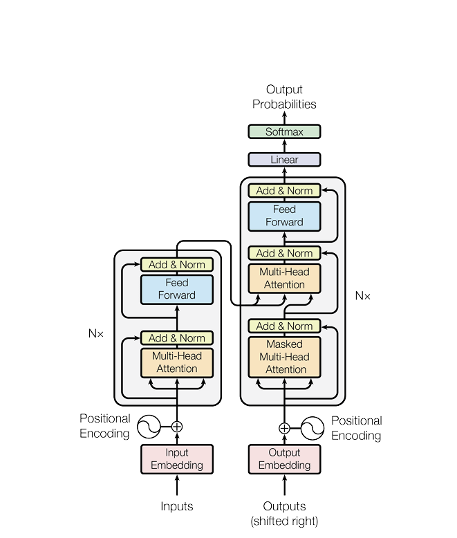
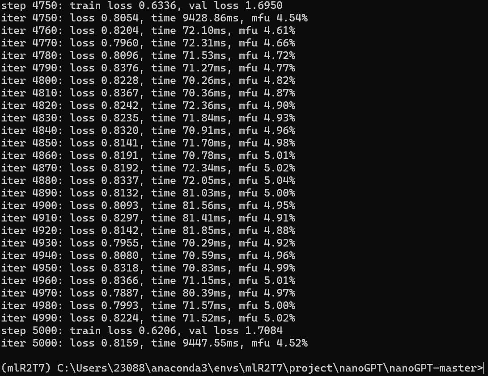

# Task 1：阅读《Attention Is All You Need》，理解 Transformer
transformer的结构就贴这方便下面解释

## Encoder 与 Decoder 的整体结构
Encoder与Decoder分别是左边和右边的两个大方块，反别重复6次
1. Encoder
Encoder从前至后分别是【多头自注意力->残差连接->层归一化->前馈神经网络（Linear->ReLU->Linear）->残差连接->层归一化】×6
1. Dncoder
Dncoder从前至后分别是【带掩码的多头自注意力->残差连接->层归一化->交叉注意力（query和key的输入来自Encoder的最终输出，value来自Decoder上一层的输出）->残差连接->层归一化->前馈神经网络（Linear->ReLU->Linear）->残差连接->层归一化】×6
## Self-Attention、Masked Self-Attention、Cross-Attention的作用
1. 首先应该先说明**注意力**的工作原理
注意力有三个输入（均是经过Embedding变成512维向量的tokens组成的矩阵），分别为Q(query)，K(key)和V(value)，这三个输入后分别乘上各自的的权重矩阵，然后$Vsoftmax(\frac{Q·K^T}{\sqrt{d_k}})$得到输出，$Q·K^T$类似于得到一个输入中各个token之间关系的打分，然后经由softmax转化成注意力权重（总和为1，防止不同token之间打分差距过大）乘上V就得到了经过注意力加权后的各token的向量，总体含义就是让token向量偏向在当前上下文中的正确含义对应的超空间中的位置
2. 自注意力
QKV三个输入都是它自己本身，反映自身每个token在当前上下文中的含义，训练模型理解句子含义的能力
3. 带掩码的自注意力
输入遮住模型要预测输出的部分，让token向量与一个三角矩阵加权运算，避免模型看到自己要预测部份的答案，训练模型通过自己生成的上下文预测输出的能力
4. 交叉注意力
QK输入来自Encoder，V来自Decoder，训练模型通过input的上下文来预测输出的能力

## Scaled Dot-Product Attention 的计算过程
$$Attention(Q,K,V)= Vsoftmax(\frac{Q·K^T}{\sqrt{d_k}})$$
$d_k$是矩阵的维度，用来防止数值过大，softmax输出相近，具体作用就和上面所讲的一样

## Multi-Head Attention 的结构与作用
多头自注意力是在注意力的基础上，乘的权重矩阵8个512×64，也就是分成了8条小线程分别进行自注意力，每个小线程学习token间的一种关系类型，最后将这8个小矩阵拼接后进行一次线性层变回512维的大矩阵，在不增加计算量的同时增强表达能力，同时可以并行计算，加快速率

## Position Encoding 的必要性
attention并不像RNN那样有先后的执行顺序，如果直接输入token向量，模型并不知道不同token之间的先后关系，所以需要Position Encoding为每个token生成代表位置的编码，加到原token向量上，以此告诉模型token之间的位置关系

## Feed-Forward Network
Linear->ReLU->Linear的MLP，将输入的维度先变为2048维经过ReLU激活后再变回512维度
在单个token内做运算，学习token自身的联系与含义，与attention学习的token间的关系形成互补

## Residual Connection 与 Layer Normalization
残差连接：让梯度有一条直接回传的路径，缓解深层网络中的梯度消失，同时避免网络的处理让原本数据的模样完全丢失
层归一化：对每个token向量在特征维度上归一化，使激活值不会过大或过小，环节梯度消失或梯度爆炸，加速收敛

## lm_head 与 softmax
推理：保留lm_head推理出的每个可能的输出的Logit，与真实内容做交叉熵损失，得到梯度，反向传播
训练：softmax后，保留最大的Logit作为输出

# Task 2：阅读 nanoGPT 源码，并与论文架构进行对应
## 项目结构
|文件|	职责|
|---|---|
|model.py|	定义 GPT、Block、CausalSelfAttention、MLP，完整的 GPT 架构与生成逻辑|
|train.py|	训练入口：数据加载、优化器、学习率调度、checkpoint保存与恢复|
|sample.py|	加载checkpoint（训练好的模型参数），执行自回归采样生成文本|
|configurator.py|	解析Python配置文件与--key=value命令行覆盖，实现配置驱动|
|config/|	各数据集的训练配置（不同数据集在训练时的超参数配置）|
|data/|	数据准备的脚本（将自然语言进行数字编码）与token的二进制文件|

## nanoGPT 模型结构
nanoGPT是decoder_only的,下面是按顺序的decoder，而且是逐字符学习的，所以每个token都是一个字符
### Token Embedding
作用：将编码好的自然语言字符转变成384/768/1024/1280/1600维度的向量，每个字符怎么转化可被机器学习
定义：GPT.\_\_init\_\_ `wte = nn.Embedding(config.vocab_size, config.n_embd),`
使用：GPT.forward `tok_emb = self.transformer.wte(idx)   # (B, T, C)`
### Position Embedding
作用：为每个位置提供一个可以学习的向量，长度等于token向量维度
定义：GPT.\_\_init\_\_ `wpe = nn.Embedding(config.block_size, config.n_embd),`
使用：
```
GPT.forward
    pos = torch.arange(0, t, dtype=torch.long, device=device)   # (T,)
    pos_emb = self.transformer.wpe(pos)                          # (T, C)
    x = self.transformer.drop(tok_emb + pos_emb)                 # 相加时广播成(B, T, C)
```
#### Transformer Block × N
定义：
```
block
    self.ln_1 = LayerNorm(config.n_embd, bias=config.bias)
    self.attn = CausalSelfAttention(config)
    self.ln_2 = LayerNorm(config.n_embd, bias=config.bias)
    self.mlp = MLP(config)
```
GPT.\_\_init\_\_ `h = nn.ModuleList([Block(config) for _ in range(config.n_layer)]),`
使用：
```
GPT.forward
    for block in self.transformer.h:
        x = block(x)
```
1. LayerNorm
作用：同上所说
定义：
```
LayerNorm
    self.weight = nn.Parameter(torch.ones(ndim))
    self.bias = nn.Parameter(torch.zeros(ndim)) if bias else None
```
`self.ln_1/2/f = LayerNorm(config.n_embd, bias=config.bias)`
2. Causal Self-Attention
作用：同上所说
定义：`class CausalSelfAttention(nn.Module)`
使用：`self.attn = CausalSelfAttention(config)`
3. Residual Connection
作用：同上所说
定义与使用：
```
block.forward
    x = x + self.attn(self.ln_1(x))   # 第 1 个 LN + Attention + 残差
    x = x + self.mlp(self.ln_2(x))    # 第 2 个 LN + MLP + 残差
```
4. LayerNorm
5. MLP
作用：同上所说
定义：
```
MLP.__init__
    self.c_fc    = nn.Linear(config.n_embd, 4 * config.n_embd, bias=config.bias)  # W1
    self.gelu    = nn.GELU()                                                       # 激活
    self.c_proj  = nn.Linear(4 * config.n_embd, config.n_embd, bias=config.bias)  # W2
```
使用：
```
MLP.forward
    x = self.c_fc(x)      # (B,T,C) → (B,T,4C)
    x = self.gelu(x)      # 逐元素
    x = self.c_proj(x)    # (B,T,4C) → (B,T,C)
    x = self.dropout(x)
```
GeLU:$GELU(x)=x·\Phi(x)$,其中$\Phi(x)$是标准正态分布
6. Residual Connection
### Final LayerNorm
同上LayerNorm
### LM Head
作用：
定义：
```
GPT.__init__
    self.lm_head = nn.Linear(config.n_embd, config.vocab_size, bias=False)
    self.transformer.wte.weight = self.lm_head.weight   #权重绑定让向量对应的token编码与解码同步，为每个可能输出打分
```
使用：
```
GPT.forward
    # 训练：所有位置
    logits = self.lm_head(x)              # (B, T, V)

    # 推理：只算最后位置
    logits = self.lm_head(x[:, [-1], :])  # (B, 1, V)
```
## Tensor Shape
B=8：batch size
T=256：一段输入的token数
C=384：每个token的向量维数
n_head=6：多头注意力中的子矩阵数

|tensor|	shape|	操作|
|---|---|---|
|input token ids|	(8, 256)|	|
|token embedding|	(8, 256, 384)|	wte(idx)按65维词表把token转化成向量|
|+ position embedding|	(8, 256, 384)|	广播相加|
|QKV合并输出|	(8, 256, 1152)|	c_attn把最后一维从384映射到3×384=1152|
|QKV拆分|	(8, 256, 384) × 3|	split沿最后一维切割|
|multi-head QKV|	(8, 6, 256, 64) × 3|view拆维度n_head × hs，新增一个维度沿最后一维拆成6个小矩阵，transpose将头数换到token数前面|
|attention matrix|	(8, 6, 256, 256)|att = q @ k^T / sqrt(hs)|
|attention output|	(8, 6, 256, 64)|att @ v|
|多头重组|	(8, 256, 384)|	transpose将头数移回token数后面，view要求内存连续，所以contiguous将原来的数据按逻辑复制出一份内存连续的矩阵， view解散头数维度，将多头输出合并|
|MLP 中间|	(8, 256, 1536)|	c_fc（4C）向量特征维度扩大四倍|
|MLP 输出|	(8, 256, 384)|	c_proj向量特征维度变回原来|
|logits|	(8, 256, 65)|	lm_head把每个token的384维映射到65维词表表示下一个token的分数|


# Task 3：部署并训练 nanoGPT
##  环境部署结果
```
python 3.14

# packages in environment 
#
# Name                     Version          Build               Channel
brotlicffi                 1.2.1.0          py314hd7fb8db_0
bzip2                      1.0.8            h2bbff1b_6
ca-certificates            2026.10.20       haa95532_0
certifi                    2026.10.23       pyhd3eb1b0_1
cffi                       2.1.1            py314h1c6eee0_0
charset-normalizer         3.4.7            py314haa95532_0
filelock                   3.32.3           pypi_0              pypi
fsspec                     2026.7.0         pypi_0              pypi
idna                       3.20             py314haa95532_0
jinja2                     3.1.6            pypi_0              pypi
libexpat                   2.9.0            hd7fb8db_0
libffi                     3.4.8            h42d73b9_3
libmpdec                   4.0.1            h1c6eee0_0
libzlib                    1.3.2            h1c6eee0_0
lz4-c                      1.9.4            h1c6eee0_5
markupsafe                 3.0.3            pypi_0              pypi
mpmath                     1.3.0            pypi_0              pypi
networkx                   3.6.1            pypi_0              pypi
numpy                      2.5.2            pypi_0              pypi
openssl                    3.5.9            hbb43b14_0
pillow                     12.3.0           pypi_0              pypi
pip                        26.2.2           pyh0d26453_0
pycparser                  3.11             py314haa95532_0
pysocks                    1.7.1            py314haa95532_2
python                     3.14.8           h7ce57fb_101_cp314
python_abi                 3.14             5_cp314
regex                      2026.9.29        pypi_0              pypi
requests                   2.34.2           py314haa95532_1
setuptools                 78.1.0           pypi_0              pypi
sqlite                     3.53.4           hee5a0db_0
sympy                      1.14.0           pypi_0              pypi
tiktoken                   0.14.0           pypi_0              pypi
tk                         9.0.4            hd2208ad_1
torch                      2.9.1+cu128      pypi_0              pypi
torchaudio                 2.9.1+cu128      pypi_0              pypi
torchvision                0.24.1+cu128     pypi_0              pypi
typing-extensions          4.16.0           pypi_0              pypi
tzdata                     2026c            he532380_0
ucrt                       10.0.22621.0     haa95532_0
urllib3                    2.8.0            py314haa95532_1
vc                         14.3             h2df5915_12
vc14_runtime               14.44.35208      h4927774_12
vs2015_runtime             14.44.35208      ha6b5a95_12
win_inet_pton              1.1.0            py314haa95532_1
xz                         5.8.4            hb851c79_0
zlib                       1.3.2            h1c6eee0_0
zstd                       1.5.7            h56299aa_0
```
python 3.14+不支持compel运算方式，所以训练时设置了compel=false

## 数据准备结果
1. 去重，排序，构建词表
对文本中所有字符去重后排序，得到 65 个唯一字符：包括大小写字母，标点，换行和空格
2. 字符与id互相构建对应关系,逐字符编码
为每一个字符对应一个数字，并让它们可以相互转换，将文本中每个字符替换成对应的数字，生成meta.pkl储存对应关系
3. 切分训练集和测试集
按9：1切分了训练集和测试集
```
train_data = data[:int(n*0.9)]
val_data = data[int(n*0.9):]
```
4. 以二进制储存文本
便于电脑快速读取文本

## 训练结果


## 文本生成结果
```
ANGELO:
Any coward, is not the disposition of all?

ISABELLA:
Nor barriage, sir, the track of home, and the confinence of much
one or of it. But it is displout mine, sir, in the state,
violent in me not to your own prince, and thus
won with a childish head, and make not
open ignorance.

ISABELLA:
It is not to do evise the time to see her death.

LUCIO:
Nor better my brother so; sir, the flower is not the
people?

ISABELLA:
I see! still your advantage against up the prey, tear you
should not fly
---------------

Men pardon, marry, see, that you say, and seement me
But with reasons and blind find with one.

First Servingman:
What, man?

MENENIUS:
So, thou art a better!

CORIOLANUS:
True, I pray, sir, sir.

CORIOLANUS:
Take you, man; go to the gods of you.

First Servingman:
This is a butcher that with you will do so.

BRUTUS:
I had the court-place, and put on't.

CORIOLANUS:
Be so it is often now.

Second Servingman:
Then in his heart.

First Servingman:
Marcius, be matter, the other in the good knees.


---------------

Messenger:
The seals I can speak to the lack of the princess;
That it was a subjects for a wealing in
To be it not, in the heart of a word,
Do call him and bear him in that action
With time sainting to do withal: therefore,
I saw my talk and gentlemen, I will thou fly.

DUKE OF YORK:
Who wilt thou then the battle souls of his?

DUKE OF YORK:
And in so doubtless must be thus be come.
Then was the queen to be so, whose babes holds
I think, no tongue's eyes and therein and by the bloody of men
---------------
```
## 实验分析
1. 训练开始和结束时 loss 有什么变化？
训练集loss从最初的4.2874最终下降到0.8159，中间有些许波动，但总体下降，反应模型确实有在学习
验证集loss从4.2823下降到1.7084，但中间有1.4781的最低值，总体来说先大幅减少然后缓慢上升，比在训练集上差，有过拟合的迹象，应该是数据集太小的原因，但不排除是选择的文本少，随机性比较大的原因，可能需要修改单次截取出来的文本的数量来检验
2. 生成文本相比未训练模型有什么变化？
未训练的模型因为参数是随机初始化的，所以生成出来的应该是随机排序的字符，没有逻辑与语义的存在，但可能存在少量可辨认单词（说不定有莎士比亚全集呢，无限猴子定理）
训练后的模型生成的就是训练集中经典的莎士比亚剧本的格式，人名：换行 台词，然后出现的单词也有莎士比亚常用的一些单词，大部分可辨认，部分拼写错误，句子基本上能看懂，但语义语法有不少瑕疵
3. n_layer、n_head、n_embd 分别控制模型的什么属性？
**n_layer**：Transformer Block 的堆叠深度。层数越多，模型能学到的自然语言层数越深（浅层学字符和局部模式，深层学句法和语义）
**n_head**：Multi-Head Attention中并行头的数量。每个头在 低维的子空间里独立学习一种注意力模式（相邻字符，角色名，标点边界）
**n_embd**：每个token示的向量维度，整个模型的宽度。维度越多，语义越丰富，模型学习的能力越强
4. block_size 表示什么？
**block_size**：模型能处理的最大上下文长度，也就是模型看多少个上文内容来预测下一个字符
5. train loss 和 validation loss 分别反映什么？
**Train loss**：模型在训练集上的交叉熵损失，反映拟合程度，也就是模型学习的程度
**Validation loss**：在不参与梯度更新的val.bin上的交叉熵损失，反映模型泛化能力，判断模型是否真正学到可迁移语言模式